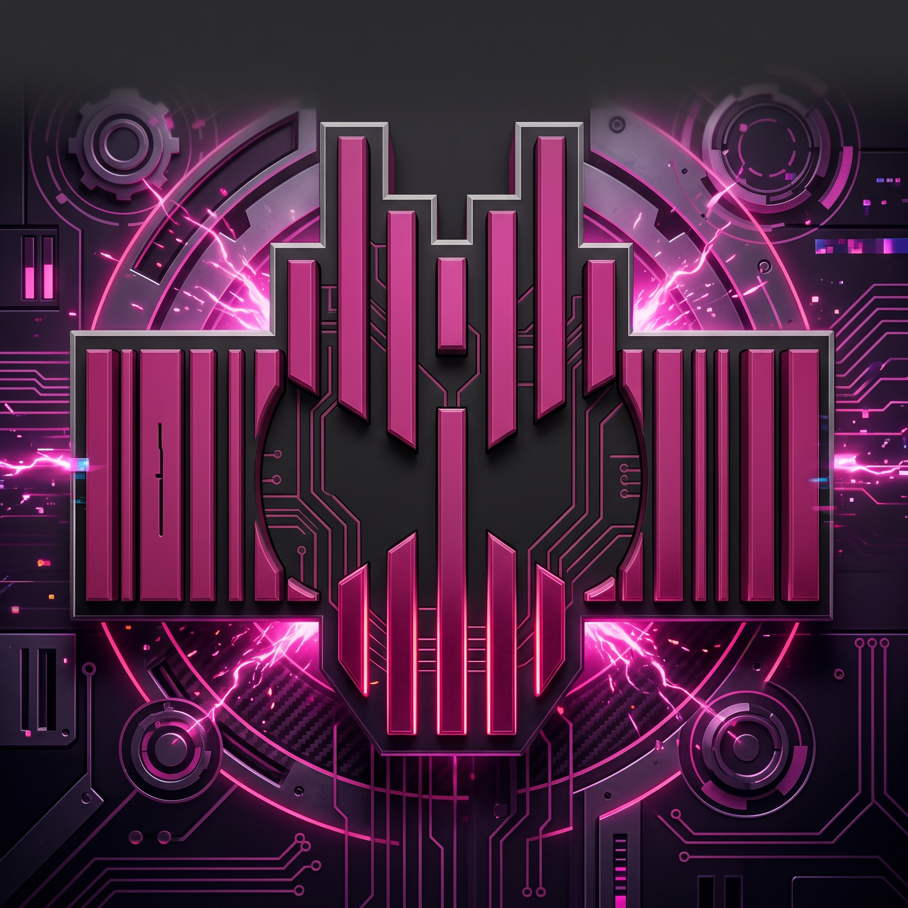

<div align="center">



# Tokuplay untuk iOS

**Aplikasi streaming tokusatsu native untuk iPhone dan iPad, dibangun dengan SwiftUI.**


</div>

Port iOS dari aplikasi Android Tokuplay, ditulis ulang dari nol (bukan konversi APK). Tanpa library pihak ketiga:
pemutar memakai AVPlayer, jaringan memakai URLSession, dan seluruh antarmuka memakai SwiftUI bawaan iOS.
Hasilnya ringan, dan kodenya kecil (sekitar 20 file Swift).

---

## Fitur

| | |
|---|---|
| **Beranda dinamis** | Tab dan seksi (Trending, Rekomendasi, Series, Movie, V-Cinext, dan lainnya) mengikuti konfigurasi dari sumber konten |
| **Pencarian instan** | Berjalan lokal di semua judul, cocok sebagian kata dan toleran salah ketik ("zetz" menemukan "Zeztz") |
| **Detail judul** | Poster, sinopsis, rating, durasi, sumber fansub, daftar episode, dan **judul terkait** |
| **Pemutar** | Pilihan kualitas, subtitle `.srt` / `.vtt` / `.ass` yang digambar sendiri di atas video, header referer otomatis |
| **Lanjut menonton** | Posisi tersimpan tiap 5 detik. Episode dilanjutkan dari menit terakhir |
| **Episode berikutnya** | Setelah selesai, hitung mundur 5 detik lalu putar episode berikutnya yang didukung |
| **Koleksi** | Bookmark dan riwayat tontonan, tersimpan lokal di perangkat |
| **Pengaturan** | Sumber konten dan kualitas default (Tertinggi / 1080p / 720p / 480p) |

## Jenis sumber video yang didukung

| Jenis | Keterangan | Status |
|---|---|---|
| `@mpd:` | Diselesaikan lewat endpoint stream milik Tokuplay menjadi link MP4 | Didukung |
| `@storage:` | Penyimpanan Tokuplay, banyak resolusi dan subtitle | Didukung |
| `@mp4:` | File MP4 berdasarkan path | Didukung |
| Buzzheavier | Mengikuti alur tombol Download di halamannya | Didukung (`.mp4`, `.m4v`, `.mov`) |
| Link langsung | `.m3u8`, `.mp4`, `.m4v`, `.mov` | Didukung |
| `#mpd:` dan manifest DASH | AVPlayer tidak bisa memutar DASH | Tidak didukung |

Episode yang tidak didukung ditandai **Belum didukung di iOS** beserta alasannya, tidak dibiarkan gagal diam-diam.

## Memulai

### Opsi 1: build lewat GitHub Actions (tanpa Mac)

1. Unggah repo ini ke GitHub.
2. Buka tab **Actions**, pilih **Build iOS (unsigned IPA)**, lalu **Run workflow**.
3. Setelah selesai, unduh artifact **TokuplayIOS-unsigned-ipa**.
4. Pasang `.ipa` ke iPhone dengan [Sideloadly](https://sideloadly.io) atau [AltStore](https://altstore.io) memakai Apple ID Anda.
   Dengan Apple ID gratis, sertifikat berlaku **7 hari** lalu perlu dipasang ulang.

Kalau build gagal, unduh artifact **xcodebuild-log** dan cari baris yang mengandung `error:`.

### Opsi 2: build di Mac

Perlu macOS, Xcode 16+, dan [XcodeGen](https://github.com/yonaskolb/XcodeGen).

```bash
brew install xcodegen
xcodegen generate            # membaca project.yml dan membuat TokuplayIOS.xcodeproj
open TokuplayIOS.xcodeproj
```

Ganti `PRODUCT_BUNDLE_IDENTIFIER` di `project.yml` dengan ID Anda sendiri, lalu pilih signing team di Xcode.

### Mengatur sumber konten

Sumber konten adalah blog Blogger dengan feed `/feeds/posts/default?alt=json`. Alamatnya bisa diisi dua cara:

- Di aplikasi: tab **Pengaturan → Sumber konten**.
- Atau sebagai nilai bawaan: kunci `TokuplayBaseURL` di `TokuplayIOS/Resources/Info.plist`.

## Struktur proyek

```
TokuplayIOS/
├─ App/          Titik masuk aplikasi, tab, kartu poster, pengaturan
├─ Data/         Klien feed Blogger, konfigurasi beranda, repository, penyimpanan lokal,
│                dekripsi string, dan plugin sumber video
├─ Domain/       Model data (Content, Episode, Server, Source, Video, Subtitle)
└─ Features/     Home, Detail, Player (+ subtitle), Search, Settings
design/          Logo sumber
project.yml      Definisi proyek untuk XcodeGen
.github/         Workflow build GitHub Actions
```

Alur singkat: **Feed Blogger → `ApiService` → `ContentRepository` → layar**. Saat episode diputar,
`StreamRepository` memilih plugin yang sesuai dengan jenis sumber, lalu `PlayerView` memutar hasilnya.

## Keterbatasan

- Subtitle ASS/SSA hanya menampilkan teks, tanpa gaya (warna, posisi, animasi).
- Format yang tidak didukung AVPlayer (misalnya `.mkv` atau manifest DASH) tidak bisa diputar.
- Belum ada: push notification, Picture in Picture, Chromecast, dan cek pembaruan.
- Tab Channel TV (siaran live) dari aplikasi Android tidak dibawa.

## Kredit dan open source

Proyek ini berdiri di atas karya banyak orang. Terima kasih kepada:

**Alat analisis**

- **[REA (Reverse Engineer Anything)](https://github.com/morluto/rea)**: perangkat reverse engineering yang dipakai untuk membaca struktur
  aplikasi Android asli (kelas, alur data, dan format sumber video) secara statis.
- **[JADX](https://github.com/skylot/jadx)** (Apache-2.0): dekompiler DEX ke Java yang menjadi mesin di balik analisis APK.
- **[Androguard](https://github.com/androguard/androguard)** (Apache-2.0): membaca resource dan string pada APK dan DEX.

**Alat build dan pemasangan**

- **[XcodeGen](https://github.com/yonaskolb/XcodeGen)** (MIT): membuat proyek Xcode dari `project.yml`.
- **[GitHub Actions](https://github.com/features/actions)**: build `.ipa` tanpa Mac.
- **[Sideloadly](https://sideloadly.io)** dan **[AltStore](https://altstore.io)**: memasang aplikasi ke iPhone dengan Apple ID.

**Teknologi yang dipakai**

- SwiftUI, AVFoundation / AVKit, CryptoKit, dan CommonCrypto dari Apple.
- [Blogger](https://www.blogger.com) sebagai penyedia feed JSON untuk konten.

**Aplikasi asli**

- Tokuplay untuk Android adalah sumber desain, struktur data, dan alur kerja yang diikuti port ini.
  Seluruh kode Swift di repo ini ditulis ulang dan tidak menyalin kode dari APK.

Dikembangkan dengan bantuan [Claude Code](https://claude.com/claude-code).
